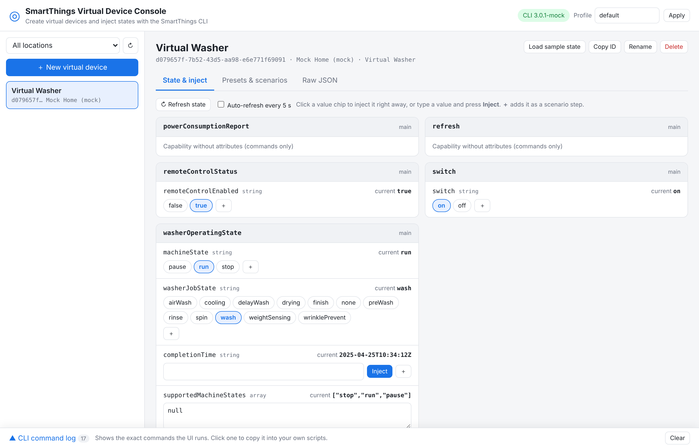

# SmartThings 가상 기기 콘솔

[English](README.md) | **한국어**



SmartThings CLI(`smartthings`)를 감싼 로컬 GUI입니다. 브라우저에서 가상 기기를 만들고, capability 속성 값을 골라 이벤트(상태)를 주입하고, 여러 이벤트를 순서대로 재생하는 시나리오를 돌릴 수 있습니다.

- 외부 npm 의존성이 없습니다. Node만 있으면 됩니다.
- 서버는 `127.0.0.1` 에만 열리고, 다른 사이트에서 오는 요청(Origin)은 막습니다.
- 쓰기 작업(이벤트 주입, 이름 변경, 삭제)은 가상 기기에만 허용됩니다.
- 시작하면 기본 브라우저가 자동으로 열립니다 (`--no-open` 또는 `ST_NO_OPEN` 으로 끔).
- UI가 실행한 CLI 명령이 하단 **CLI 명령 로그**에 그대로 남아서, 스크립트로 옮길 때 복사해 쓸 수 있습니다.

## 준비

1. **Node.js** 설치 (최신 CLI 3.x는 Node 24 이상을 요구합니다)
2. **SmartThings CLI** 설치

   ```bash
   npm install -g @smartthings/cli
   # 또는 Homebrew
   brew install smartthingscommunity/smartthings/smartthings
   smartthings --version
   ```

3. **인증** (둘 중 하나)
   - 브라우저 로그인: 아무 명령이나 처음 실행하면 CLI가 로그인 창을 엽니다. 미리 해두려면 `smartthings locations` 를 한 번 실행하세요.
   - PAT(개인 액세스 토큰): https://account.smartthings.com/tokens 에서 발급 후 아래처럼 환경변수로 넘깁니다. 권한은 최소 `Devices`(읽기/쓰기/실행), `Locations`(읽기) 가 필요합니다.

     ```bash
     export SMARTTHINGS_TOKEN=xxxxxxxx-xxxx-...
     ```

## 실행

```bash
# 설치 없이 바로 실행
npx github:Twohyunpa/SmartThings_Virtual

# 또는 저장소를 받아서 실행 (Windows/macOS/Linux 공통)
git clone https://github.com/Twohyunpa/SmartThings_Virtual.git
cd SmartThings_Virtual
npm start            # 또는 node server.js
# → http://127.0.0.1:3700 을 브라우저로 엽니다
```

Windows PowerShell 에서 환경변수는 `$env:SMARTTHINGS_TOKEN="..."; npm start` 형식으로 지정합니다.

SmartThings 계정 없이 UI만 먼저 보고 싶으면 모의 CLI로 실행하세요.

```bash
npm run mock
```

### 환경변수

| 변수 | 기본값 | 설명 |
| --- | --- | --- |
| `PORT` | `3700` | 웹 서버 포트 |
| `ST_CLI` | `smartthings` | CLI 실행 파일 경로. `.js` 로 끝나면 `node` 로 실행 |
| `ST_PROFILE` | `default` | CLI 설정 프로필 (`~/.config/@smartthings/cli/config.yaml`). UI 상단에서도 바꿀 수 있음 |
| `SMARTTHINGS_TOKEN` | – | PAT. 지정하면 브라우저 로그인 없이 사용 |
| `ST_NO_OPEN` | – | 값이 있으면 시작할 때 브라우저를 자동으로 열지 않음 (`--no-open` 인자도 동일) |
| `ST_CLI_TIMEOUT_MS` | `120000` | CLI 명령 하나의 최대 실행 시간 |

## 기능

**가상 기기 만들기**
- 삼성 가전 템플릿: 세탁기, 건조기, 에어컨, 공기청정기, 로봇청소기, 식기세척기, TV, 냉장고. 프로필 정의(JSON)를 열어서 capability를 더하거나 뺄 수 있습니다. 템플릿은 `templates/samsung-appliances.json` 에서 고치면 됩니다.
- 표준 프로토타입: `VIRTUAL_SWITCH`, `VIRTUAL_MOTION_SENSOR` 등 17종 (`virtualdevices:create-standard`)
- 내 디바이스 프로필 ID로 만들기, 또는 프로필 JSON 직접 입력 (`virtualdevices:create`)
- dry-run 버튼으로 실제 생성 없이 요청 JSON을 확인할 수 있습니다.

**상태 & 주입**
- 기기의 component/capability 별로 속성과 현재 값이 표시됩니다.
- capability 정의를 읽어 컨트롤을 자동으로 만듭니다: enum은 칩(누르면 바로 주입), 숫자는 슬라이더/입력 + 단위, 배열/객체는 JSON 입력.
- 5초 자동 새로고침, 직접 입력(component/capability/attribute/value/unit)도 지원합니다.

**프리셋 & 시나리오**
- 템플릿 프리셋(예: 세탁 시작 → 헹굼 → 탈수 → 완료)이 기기 capability와 맞으면 자동으로 보입니다.
- 상태 탭의 ＋ 버튼으로 단계를 모아 시나리오를 만들고, 단계별 대기 시간(ms)과 반복 실행을 설정할 수 있습니다.
- 시나리오는 브라우저(localStorage)에 저장되고 JSON으로 가져오기/내보내기가 됩니다.

**기타**: 이름 변경, 삭제, 원본 JSON(`devices`, `devices:status`) 보기, CLI 명령 로그(클릭하면 복사).

## 템플릿 출처

삼성 가전 템플릿은 임의로 만든 것이 아니라 [Home Assistant](https://github.com/home-assistant/core)의 SmartThings 테스트 데이터(`tests/components/smartthings/fixtures`, Apache-2.0, [NOTICE](NOTICE) 참고)에서 생성합니다. 실제 삼성 가전에서 덤프한 데이터이고, `tools/build-templates.py`가 모델별 capability 목록과 샘플 속성 값을 추출합니다. 기본은 표준 capability만 쓰고, `custom.*`/`samsungce.*` 같은 삼성 전용 capability는 옵션입니다(가상 기기에서 거부될 수 있음). 자세한 내용은 영어 [README](README.md) 참고.

## 사용하는 CLI 명령

| 동작 | 명령 |
| --- | --- |
| 위치/방 목록 | `smartthings locations`, `smartthings locations:rooms -l <locationId>` |
| 가상 기기 목록 | `smartthings virtualdevices [-l <locationId>]` |
| 기기 정보/상태 | `smartthings devices <id>`, `smartthings devices:status <id>` |
| capability 정의 | `smartthings capabilities <id> --capability-version 1` (CLI 1.x는 `capabilities <id> 1`) |
| 생성 | `smartthings virtualdevices:create-standard -i input.json`, `smartthings virtualdevices:create -i input.json` |
| 이벤트 주입 | `smartthings virtualdevices:events <id> -i input.json` |
| 이름 변경/삭제 | `smartthings virtualdevices:update <id> -i input.json`, `smartthings virtualdevices:delete <id>` |

모든 명령에 `--json` 을 붙여 결과를 파싱합니다. CLI 1.10.x와 3.x 둘 다 동작하도록 버전을 감지해 인자를 맞춥니다.

## 알아둘 점

- 삼성 가전 템플릿은 SmartThings 표준 capability만 씁니다. 실제 삼성 가전이 쓰는 `samsungce.*` 같은 전용 capability가 필요하면 템플릿 JSON에 추가해 보세요. 계정 권한에 따라 가상 기기에서 거부될 수 있습니다.
- 가상 기기는 실제 SmartThings 계정의 선택한 위치에 만들어지고, SmartThings 앱과 자동화(루틴)에도 그대로 보입니다.
- 이벤트 주입은 클라우드 가상 기기 기준입니다. 허브에서 로컬 실행하는 가상 기기(`--local`)는 이 UI에서 만들지 않습니다.

## 라이선스

MIT. 자세한 내용은 [LICENSE](LICENSE) 참고.
