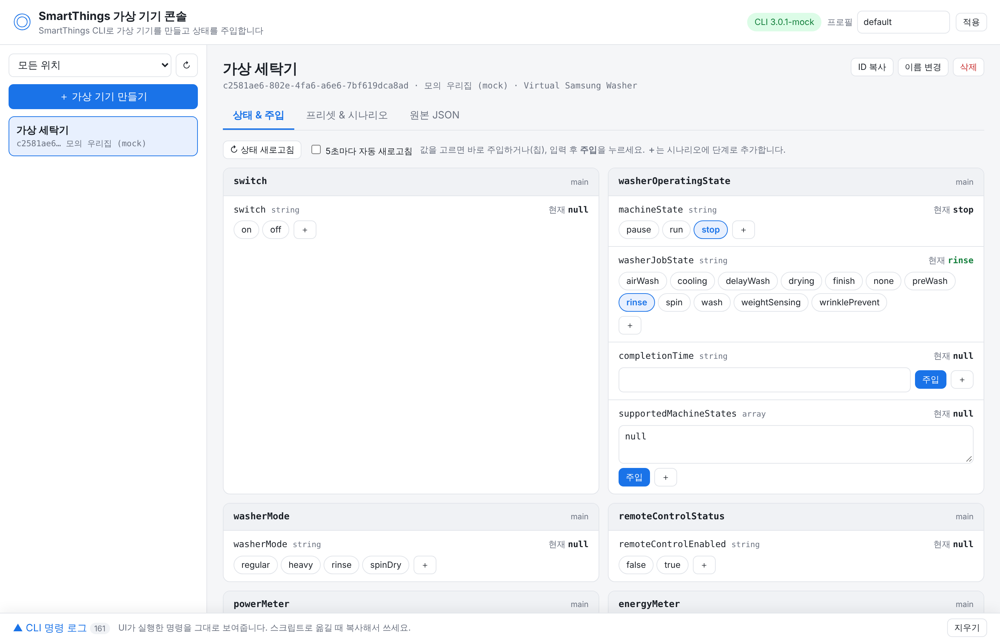
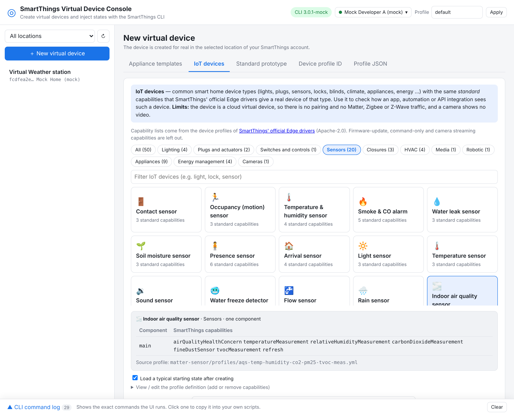

# SmartThings Virtual Device Console

[English](README.md) | [한국어](README.ko.md)



A local GUI that wraps the [SmartThings CLI](https://github.com/SmartThingsCommunity/smartthings-cli). Create virtual devices, inject states (events) into them, and replay scenarios from the browser instead of running scripts by hand.

- No npm dependencies. Node.js is all you need.
- The server listens on `127.0.0.1` only and rejects requests from other origins.
- Every CLI command the UI runs is shown in the **CLI command log** at the bottom, so you can copy it into your own scripts.
- Write operations (inject events, rename, delete) are only allowed on virtual devices.
- Runs on macOS, Windows and Linux.

## Quick start

Prerequisites:

1. **Node.js** (the latest CLI 3.x needs Node 24 or newer)
2. **SmartThings CLI**

   ```bash
   npm install -g @smartthings/cli
   # or with Homebrew
   brew install smartthingscommunity/smartthings/smartthings
   smartthings --version
   ```

3. **Authentication** (either one)
   - Browser login: run any command once and the CLI opens a login window, e.g. `smartthings locations`.
   - Personal access token (PAT): create one at https://account.smartthings.com/tokens and pass it as an environment variable. It needs at least the `Devices` (read/write/execute) and `Locations` (read) scopes. New PATs may expire after 24 hours.

     ```bash
     export SMARTTHINGS_TOKEN=xxxxxxxx-xxxx-...
     ```

Run:

```bash
# run without installing anything
npx --yes github:Twohyunpa/SmartThings_Virtual

# or clone and run (Windows / macOS / Linux)
git clone https://github.com/Twohyunpa/SmartThings_Virtual.git
cd SmartThings_Virtual
npm start
```

Your default browser opens http://127.0.0.1:3700 automatically (disable with `--no-open`). On Windows PowerShell, set variables like `$env:SMARTTHINGS_TOKEN="..."; npm start`.

To try the UI without a SmartThings account, run it against the built-in mock CLI:

```bash
npm run mock
```

Run the automated tests (uses the mock CLI, no account needed):

```bash
npm test
```

### Environment variables

| Variable | Default | Description |
| --- | --- | --- |
| `PORT` | `3700` | Web server port |
| `ST_CLI` | `smartthings` | Path to the CLI executable. Paths ending in `.js` are run with `node` |
| `ST_PROFILE` | `default` | CLI config profile. Can also be changed from the top bar |
| `SMARTTHINGS_TOKEN` | – | PAT. Skips the browser login |
| `ST_NO_OPEN` | – | If set, do not open the browser on start (same as `--no-open`) |
| `ST_CLI_TIMEOUT_MS` | `120000` | Maximum run time of a single CLI command |
| `ST_CLI_CONCURRENCY` | `5` | Maximum number of CLI commands run at the same time |

## Features

**Create virtual devices**

The **New virtual device** panel has five tabs, and each tab shows a short explanation of what it does and when to use it.

- Appliance templates: 35 real Samsung models (washers, dryers, dishwashers, air conditioners, air purifiers, refrigerators, robot vacuums, ovens, a cooktop, a range hood, a TV, a soundbar ...). Their capability lists and sample attribute values are taken from real devices, see [Where the templates come from](#where-the-templates-come-from). You can open the profile JSON and add or remove capabilities.
- IoT devices: 50 common smart home device types: lights, plugs, a button, 20 kinds of sensors (contact, motion, presence, arrival, temperature, humidity, light, sound, pressure, flow, rain, water leak, water freeze, soil, air quality, multipurpose, security zone, weather station, smoke/CO, CO), door lock, blinds, garage door, thermostat, fan, air purifier, heat pump, TV, robot vacuum, washer, dryer, dishwasher, refrigerator, oven, cooktop, range hood, microwave, air conditioner, EV charger, solar, home battery, water heater and camera/doorbell. Filter by category or search by name. See [IoT devices](#iot-devices).
- Standard prototypes such as `VIRTUAL_SWITCH` and `VIRTUAL_MOTION_SENSOR` (17 in total, `virtualdevices:create-standard`).
- Create from one of your own device profile IDs, or paste a profile JSON (`virtualdevices:create`).
- The dry-run button shows the request JSON without creating anything.

**State & inject**
- Two-pane layout: a capability list on the left (each entry shows its current value, with a filter box) and the details of the selected capability on the right.
- A one-line **state summary** bar sits on top; click an item to jump to that capability.
- **Custom event** (component / capability / attribute / value / unit) is always at the top of the right pane.
- Star (☆/★) the capabilities you use often. Pinned capabilities move to a *Pinned* group at the top of the list and stay open right under Custom event, in pin order. Your last selection and pins are remembered per device.
- Shows the attributes of every component / capability with their current values.
- Controls are generated from the capability definitions: enums become chips (click to inject immediately), numbers get a slider / input plus a unit, arrays and objects take JSON.
- Values that have a matching `supported*` / `available*` list (e.g. `fanMode` ↔ `supportedAcFanModes` / `availableAcFanModes`) become a dropdown filled from the device's **current** list, and the lists themselves become checkboxes. The options follow the device state, so after you inject a new supported list the dropdown updates. Pick **Custom value…** (or **Edit as JSON**) to inject a value outside the list, e.g. to test how an app handles invalid input. Values outside `available*` are marked ⚠.
- `supported*` / `available*` lists are edited as a checkbox list: tick or untick values, type a new one and press **Enter** or click **Add**, then **Inject**. A value still in the text box is included when you inject.
- An **ⓘ** button next to every `supported*` / `available*` attribute explains the difference: `supported*` is what the device model can ever do, `available*` is what can be chosen right now, a subset that changes with the current mode. Tip: inject a shorter `available*` list to check that your app hides or blocks the rest.
- Optional 5-second auto-refresh.

**Presets & scenarios**
- Template presets (e.g. start wash → rinse → spin → finished) appear automatically when they match the device's capabilities.
- Collect steps with the ＋ buttons on the State tab, set a delay per step, and replay them once or in a loop.
- Scenarios are stored in your browser (localStorage) and can be imported / exported as JSON.

**Account**: the account menu at the top right shows which SmartThings account the CLI is signed in to (its default organization and locations; SmartThings has no public API that returns your email), and how it is signed in (browser login, `SMARTTHINGS_TOKEN`, or a token in the CLI profile).
- **Log out** runs `smartthings logout`, which removes the CLI's stored login for the current profile. Your devices are not touched.
- **Switch account** logs out and then starts a fresh browser login. If the browser signs you straight back in to the same account, sign out of your Samsung account on that page (or at account.samsung.com) and try again.
- With `SMARTTHINGS_TOKEN` (or a token in `config.yaml`) the token decides the account, so these buttons are disabled; restart with another token instead.
- Signed out, the app shows a **Sign in** button instead of opening a login window by itself.

**Also**: rename, delete, raw JSON view (`devices`, `devices:status`), and the CLI command log (click an entry to copy it).

**Error handling**: when a CLI command fails, the error is shown in the UI with a clearer message and also printed to the terminal (`[cli failed] ...`). The server keeps running after unexpected errors, and tells you if port 3700 is already in use (start on another port with `PORT=3800 npm start`).

## Where the templates come from

The templates are not hand-picked. They are generated from the SmartThings test fixtures of [Home Assistant](https://github.com/home-assistant/core) (`tests/components/smartthings/fixtures`, Apache-2.0, see [NOTICE](NOTICE)), which are dumps of real Samsung appliances. `tools/build-templates.py` extracts each model's components, capabilities and sample attribute values; the upstream commit is recorded in `templates/samsung-appliances.json`.

Only **standard SmartThings capabilities** (`switch`, `washerOperatingState`, `ovenMode`, `temperatureMeasurement` ...) are used, because they work for any virtual device. The Samsung-specific capabilities that the real devices also have (`custom.*`, `samsungce.*`, `hca.*`, `sec.*`) and the OCF/cloud plumbing ones (`ocf`, `execute`, `logTrigger`, `demandResponseLoadControl`) are deliberately left out, and models that end up with fewer than 4 standard capabilities are skipped. After creating a device, **Load sample state** injects the values recorded from the real appliance. To regenerate the templates from a newer Home Assistant checkout, see the header of `tools/build-templates.py`. `npm run check-capabilities` verifies that your account can see every capability the templates use.

## IoT devices



When a real device is added to SmartThings, whether it speaks Matter, Zigbee or Z-Wave, a SmartThings Edge driver gives it a device profile made of **standard capabilities** (`switch`, `switchLevel`, `lock`, `temperatureMeasurement` ...). Apps, automations and cloud integrations only ever see that profile, not the radio protocol. The **IoT devices** tab creates a virtual device with the same profile, so they see what they would see for a real device of that type.

- **Device types and categories follow the Matter 1.5 Device Library.** There is no other cross-vendor list of smart home device types, so the templates are grouped by its chapters: Lighting, Plugs and actuators, Switches and controls, Sensors, Closures, HVAC, Media, Robotic, Appliances, Energy management, Cameras (and Other for anything that does not fit). The Samsung appliance templates use the same categories. Where a template matches a Matter device type, `templates/iot-devices.json` records it in the `matter` field, for reference only.
- The profiles are taken from [SmartThings' official Edge drivers](https://github.com/SmartThingsCommunity/SmartThingsEdgeDrivers) (`drivers/SmartThings/*/profiles`, Apache-2.0, see [NOTICE](NOTICE)) by `tools/build-iot-templates.py`, mostly from the `matter-*` drivers and, for a few sensors with no Matter profile (arrival, sound, multipurpose, security zone), from `zigbee-*` / `zwave-*` drivers. The upstream commit is recorded in `templates/iot-devices.json`.
- Left out: `firmwareUpdate`, command-only `stateless*` capabilities, camera streaming and storage capabilities (`webrtc`, `videoCapture2`, ...) and vendor capabilities such as `vision.*`.
- Each device starts with a typical state (for example a light at 70 %, a lock locked), and presets such as *Lock: forced opening attempt*, *Alarm: smoke detected*, *Cycle: running* or *EV charger: plugged in, charging* appear on the **Presets & scenarios** tab.
- Devices created from an IoT device template are marked **IoT** in the device list.

**Limits.** These are cloud virtual devices. There is no pairing (QR / pairing code), no Matter, Zigbee or Z-Wave traffic, and the camera shows no video. To test the Matter protocol itself, use a real or emulated Matter device with a SmartThings hub, for example Samsung's [Matter Virtual Device](https://developer.samsung.com/smartthings/blog/en/2023/12/14/creating-a-matter-virtual-device).

Some newer capabilities (for example `operationalState`, `evseState`, `cameraPrivacyMode`, `rainSensor`) may not be accepted for virtual devices on every account. Run `npm run check-capabilities` once (or, without cloning, `npx --yes -p github:Twohyunpa/SmartThings_Virtual st-check-capabilities`): it lists any capability your account cannot see and the templates that use it. Remove that capability in **View / edit the profile definition** before creating.

## CLI commands used

| Action | Command |
| --- | --- |
| Locations / rooms | `smartthings locations`, `smartthings locations:rooms -l <locationId>` |
| List virtual devices | `smartthings virtualdevices [-l <locationId>]` |
| Device info / status | `smartthings devices <id>`, `smartthings devices:status <id>` |
| Capability definition | `smartthings capabilities <id> --capability-version 1` (CLI 1.x: `capabilities <id> 1`) |
| Create | `smartthings virtualdevices:create-standard -i input.json`, `smartthings virtualdevices:create -i input.json` |
| Inject events | `smartthings virtualdevices:events <id> -i input.json` |
| Rename / delete | `smartthings virtualdevices:update <id> -i input.json`, `smartthings virtualdevices:delete <id>` |
| Account | `smartthings organizations`, `smartthings logout` (sign-in: any command, e.g. `smartthings locations`, opens the browser login) |

All commands are run with `--json` and parsed. The server detects the CLI version and adjusts arguments, so both CLI 1.10.x and 3.x work.

## Notes

- Virtual devices are created in the selected location of your real SmartThings account, so they also show up in the SmartThings app and in routines.
- Event injection targets cloud virtual devices. Hub-local virtual devices (`--local`) are not created by this UI.
- Reading status (`devices`, `devices:status`) works for any device id; all changes are restricted to virtual devices.

## License

MIT. See [LICENSE](LICENSE).
